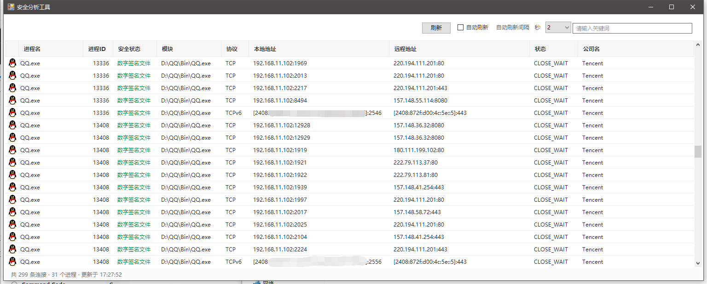

# NetMonitor

一个仿「火绒安全分析工具」网络模块的 Windows 网络连接监视器。用 C# / WinForms 编写，单文件编译，无第三方依赖。

[](LICENSE)
[]()
[]()



## 功能

- **实时连接列表** — 通过 `GetExtendedTcpTable` 直接读取内核 TCP 连接表，拿到每条连接的所属 PID
- **IPv4 / IPv6** — 双栈支持，IPv6 用方括号包裹主机部分（`[2408:8266::1]:443`），与端口明确区分
- **进程信息** — 进程名、完整路径、公司名、程序图标
- **安全状态** — 校验数字签名（含 Windows 目录签名），已签名绿色、未签名红色
- **自动刷新** — 可选开关，间隔 1/2/3 秒，默认关闭
- **手动刷新** — 顶部「刷新」按钮或 F5
- **关键词过滤** — 按进程名、IP、公司名实时筛选，输入框内带一键清空按钮
- **加载动画** — 首次取数时显示转圈动画
- **多语言** — 简体中文 / 繁體中文 / English，可在界面切换，文案放在 `lang/*.ini` 里可直接改
- **窗口记忆** — 记住窗口位置、大小、刷新设置和语言

### 右键菜单

| 菜单项 | 说明 |
| --- | --- |
| 复制远程地址 | 只复制 IP，不含端口 |
| 查询远程地址 IP 信息 | 用默认浏览器打开 `geoip.loukky.com` 查询归属地 |
| 查看进程属性 | 打开系统文件属性对话框 |
| 打开文件所在位置 | 在资源管理器中定位并选中该 exe |
| 结束进程 | 二次确认后结束进程 |

## 系统要求

- Windows 10 / 11（x64）
- .NET Framework 4.5+（系统自带）
- **需要管理员权限**（读取系统进程信息、结束受保护进程所需）

## 使用

直接双击 `NetMonitor.exe`，UAC 提示点「是」。

## 从源码编译

不需要安装 Visual Studio，用系统自带的 C# 编译器即可：

```bat
C:\Windows\Microsoft.NET\Framework64\v4.0.30319\csc.exe ^
  /target:winexe /out:NetMonitor.exe /win32manifest:app.manifest /win32icon:app.ico ^
  /r:System.dll /r:System.Drawing.dll /r:System.Windows.Forms.dll /r:System.Data.dll ^
  Native.cs Settings.cs Lang.cs ProcActions.cs MainForm.cs GridData.cs Program.cs
```

或双击 `build.bat`。

## 多语言

界面右上角可切换语言，选择会记进 `settings.ini`，下次启动保持。没选过则按系统区域自动判断（繁中地区给繁中，其他中文给简中，其余英文）。

文案放在 exe 同级的 `lang/` 目录，纯文本 ini，改完重启即生效，不用重新编译：

```
lang/zh-TW.ini
lang/en-US.ini
```

格式是 `[分组]` + `键=值`，实际键名是 `分组.键`，比如 `[col]` 下的 `name` 对应 `col.name`。多行文案用 `\n` 表示换行。**删掉某一行会退回内置的简体中文**，所以只需要翻译你关心的部分。简体中文本身内置在程序里，没有 `lang/zh-CN.ini` 也能正常工作。

想加第三种语言：复制一份 ini 改内容，再在 `Lang.cs` 的 `Codes` 数组里加上语言代码即可。

## 项目结构

| 文件 | 职责 |
| --- | --- |
| `Native.cs` | TCP 连接表读取（iphlpapi）、进程快照、IPv6 格式化 |
| `Settings.cs` | 窗口位置/大小/刷新/语言设置的持久化 |
| `Lang.cs` | 多语言加载，内置简中兜底 + `lang/*.ini` 覆盖 |
| `ProcActions.cs` | 进程属性、打开位置、结束进程、数字签名校验 |
| `MainForm.cs` | 界面构建、刷新调度、签名着色 |
| `GridData.cs` | 数据装载、右键菜单、缓存与过滤 |
| `Program.cs` | 程序入口与自检 |
| `app.manifest` | UAC 清单（requireAdministrator） |
| `app.ico` | 程序图标，7 种尺寸（16–256） |
| `lang/*.ini` | 界面文案（繁中、英文），可自行增改 |

## 自检

代码内置两套断言自检，改完可以直接跑：

```bat
NetMonitor.exe --check      :: 网络层、签名、进程操作、三套文案齐全
NetMonitor.exe --check-ui   :: 界面、菜单定位、刷新行为、切换语言
```

## 已知限制

- 普通权限下部分系统进程会显示为「PID xxxx」，这是 Windows 的进程访问限制，以管理员运行即可看到全部
- 只监测 TCP，不含 UDP
- 签名校验首次加载约需数秒（后台进行，不阻塞界面）

## 许可

MIT
